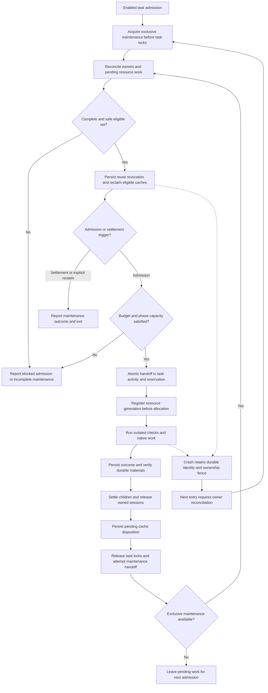

# Design: task resource lifecycle

## 1. Status and existing contracts
Status: proposal only. No current command gains deletion behavior through these
documents. The accepted [storage specification](../../specs/release-storage/spec.md)
and [storage reader guide](../../../docs/release-storage.md) describe bounded,
non-atomic observations and non-executable previews. Their conservative historical
reference rules remain intact. `cleanup.mjs` guards subprocess settlement and locks;
it is not a disk collector.

The runner already preserves install/check policies, source-bound UI evidence,
once-only native build attempts and publication checkpoints. The standalone
coordination companion supplies activity/maintenance exclusion. Consumers install
that companion separately, so changing the package is insufficient to change
managed admission. Project adapters are trusted operator inputs, never imported
from a candidate checkout or selected by a journal.

## 2. Objectives and invariants
1. Preserve isolated, pinned source execution and the complete applicable checks.
2. Keep durable delivery/evidence/recovery facts independent of cache availability.
3. Permit deletion only of explicitly registered, independently rebuildable leaves.
4. Never infer authority from age, exit zero, saved preview JSON or a dead parent PID.
5. Never invalidate a build/upload/submission intent into permission to replay it.
6. Make missed finalization recoverable at the next task entry, without a daemon.
7. Bound cache retention when resources are eligible; report protected overage and
   refuse new allocation when the budget cannot be met safely.

These are cooperative local-process guarantees, not a sandbox against an unrelated
process with the same filesystem privileges. Unmanaged writers must be stopped or
adopted before enabling mutations; otherwise admission fails closed.

## 3. Scope and ownership
| Owner | Responsibility |
| --- | --- |
| Release Kit | Resource records, schema/feature fencing, fresh eligibility checks, bounded reclamation, capacity admission, runner hook contract and reports |
| Trusted consumer adapter | Exact paths and resource classes, rebuild command semantics, required outputs, receipt/reference interpretation, source cleanliness and owned native-session control |
| Managed bootstrap | Stable installation identity, exclusive maintenance/activity admission, dispatch reconciliation and prevention of bypass by direct/worker entry |
| Operator | Enable a reviewed policy during maintenance, classify legacy material separately and authorize any service/runtime removal outside this scope |

Only resources within one explicitly configured private state root are eligible in
v1. Paths outside it, toolchain installations and historical manual build folders
remain protected/unmanaged. A later legacy cleanup operation needs a separate
reviewed import manifest and authorization; there is no recursive auto-discovery
that turns unknown directories into disposable caches.

## 4. Three resource classes
| Class | Examples | Policy |
| --- | --- | --- |
| Durable | Final packages, signing inputs, journals, reports, necessary screenshots, source provenance and non-reconstructable inputs | Never reclaimed by cache retention |
| Rebuildable | Adapter-declared compiler intermediates, indexes or dependency installations | Eligible only after ownership, references and reconstruction are verified |
| Running | A task-created native simulator session, Metro or fixture subprocess | Release only task-owned sessions after all recorded users/children settle |

Do not register all of DerivedData as disposable merely because most of it is
intermediate output. App binaries, build products, logs or files referenced by
receipts may live underneath it. Prefer precise intermediate leaves, preserving
products and evidence. Whole workspaces are eligible only when every contained
resource and retained reference has been classified and cleared.

Source revision alone is not reconstruction proof: frozen dependency inputs,
toolchain identity, uncommitted patches, special downloads and signing dependencies
also matter. Non-retrievable inputs stay durable. Changing the resource policy does
not retroactively reclassify existing registrations.

## 5. Proposed interfaces and activation
Existing `storage-inspect` / `storage-plan` remain standalone reads with unchanged
arguments, output schemas and no apply support.

Add `storage-reclaim --config <trusted-config> --dry-run` and
`storage-reclaim --config <trusted-config>`. Both load only the explicitly supplied
trusted configuration/adapter; dry-run performs no writes or session termination,
and produces no reusable deletion authorization. Mutation obtains maintenance and
reassesses the live root; it never accepts a saved plan or arbitrary deletion paths.
Resource status is exposed through the same bounded report, with separate task and
maintenance results. The exact exit-code mapping must be frozen in implementation
before consumer integration: success, protected/insufficient capacity, incomplete
observation and cancellation must remain machine-distinguishable.

Lifecycle is disabled when configuration is absent. Activation requires a reviewed
adapter/policy and bootstrap supporting this contract. Enabled policy supplies:
- a positive retained-cache byte budget;
- a positive minimum free-space floor on the actual allocation filesystem;
- a positive per-operation allocation estimate for the admitted heavy phase;
- existing bounded command/observation timeouts and the policy identity.

There is no invented universal GB default or age-based deletion timer. Initial
consumer values come from isolated cold/warm measurements. Validate policy at its
trusted boundary; do not load alternate policies from resource records.

The retained-cache budget uses measured logical bytes in registered cache leaves,
counting a device/inode once within the declared root. Reject overlapping resource
registrations; uncertain external hard links protect the resource. This deterministic
policy metric is distinct from volume free bytes and never predicts physical space
recovery. Update last-use sequence only on verified resource use, not status reads,
previews or a failed attempt to acquire it. Newly created unmeasured caches remain
reserved/protected until observed; missing measurements cannot count as zero.

Every enabled local, worker and direct runner path must present a current admission
capability bound to the installation/root/policy and operation. A bypass path fails
before installation, workspace allocation or native execution. The core must not
silently assume the managed wrapper was used. Read-only status/inspection and
reconciliation of an already uncertain provider operation remain accessible without
native allocation; storage pressure does not trigger or authorize provider writes.

## 6. Ledger and compatibility
Use one private resource ledger under the existing state root, outside all cache
targets: `resources/events/` with ordered append-only events and an atomically
replaceable derived index. The ledger is subordinate local resource bookkeeping,
not a second release/publication ledger. Rebuild the index from verified events;
corruption, unsupported schemas or divergent identities block mutation.

Each registration binds resource ID/generation, release/task identity, declared
relative path/class, source and toolchain/policy identity, directory identity,
reconstruction dependencies, users, last-use event sequence and protection reasons.
Write the intent before creating a resource, then record observed identity before
use. Interrupted creation remains pending reconciliation; never adopt an unrelated
pre-existing directory. Do not store secrets or raw provider data.

Disk states: `retained -> pending -> reclaiming -> reclaimed`. Cancellation before
mutation may return pending to retained with a reason; protected or failed actions
remain pending with their blocker, never reported reclaimed. Rebuilding creates a
new generation; it does not erase the previous reclaim history. Running sessions
use `owned -> release-pending -> released`, with ownership uncertainty as a blocker.

Keep plan/request IDs and schema-v1 historical event bytes unchanged. Cache reuse
consults resource generation and file presence in addition to historical success.
Reclaim records durably revoke reuse for the affected install/check/cache outputs
before any removal. They do not change historical acceptance results or reset
build/publication side-effect stages. If a required UI output is lost, reuse is
unavailable until a new valid check/receipt exists; the old report remains historical.

After activation, a stable compatibility marker prevents older installed controls
from resuming without lifecycle-aware reuse checks. Deploy that fence in the
standalone bootstrap and runner before the first deletion. An older control that
ignores this ledger is not a safe rollback target. Rollback either disables new
execution while retaining the fence or reconstructs/validates affected outputs and
proves compatibility under maintenance; never just remove the marker. Supporting
this feature must include old-reader refusal and rollback tests, not only new-reader
parsing of old journals.

## 7. Two mandatory triggers, one reclaim implementation
### Admission, before allocating a heavy phase
1. Validate installation, policy and feature compatibility.
2. Before taking task/release/UI activity locks, acquire the existing exclusive
   maintenance lease for the coordination domain. Concurrent admissions use the
   existing bounded wait/busy result; no automatic owner takeover.
3. Verify all activity, dispatch, target and cleanup ownership. Reconcile only with
   existing supported proofs; PID absence or elapsed time is insufficient.
4. Recover pending resource operations and compute a fresh, bounded eligible set.
5. Reclaim oldest eligible resources until the retained-cache budget is met and
   measured free space can cover the floor plus this phase's allocation estimate.
6. Atomically transfer maintenance to task activity and record the phase's capacity
   reservation without an unguarded admission gap. If atomic handoff is not supported
   yet, implementation must add and test it before enabling hooks.

Reservations coordinate only writers in this domain. Account for outstanding
reservations, avoid double-counting a task's own reservation, and recheck before a
later heavy phase. External disk use can still invalidate estimates; native ENOSPC
must produce an honest failure, not a completeness or reservation guarantee.
Never exceed the policy by silently treating protected resources as disposable.

### Settlement, after children and evidence settle
First record the task outcome and durable evidence integrity. Before relinquishing
task activity, append the cache disposition and any pending resource work. Release
owned sessions while their ownership is still held. Only after task/release/UI locks
are released may the wrapper atomically transition its activity into maintenance.
If other activity prevents exclusive maintenance, retain pending work and release
only the current owned activity; the next admission retries assessment.

Use the same collector as admission, not a second cleanup script. Do not acquire
maintenance while still holding a task activity that excludes it. A busy collector
does not convert successful release/acceptance into failure: reports distinguish the
task outcome from reclamation outcome. Incomplete subprocess cleanup retains the
existing fence and blocks destructive collection.

### Crash and no-next-task limits
Persist the task/resource admission identity before allocation. A crash before the
settlement event is still discoverable on the next entry. Stale coordination records
must be reconciled first, not automatically stolen. No guarantee of immediate
reclamation exists while the machine is off or no new invocation occurs. Explicit
`storage-reclaim` can perform the same maintenance path while idle. No cron or daemon
is introduced in v1.

## 8. Eligibility and deletion transaction
Under exclusive maintenance, all of the following must hold:
- registration and policy generation are supported and belong to this root;
- the resource has no active user, unknown writer or unresolved cleanup owner;
- source/reconstruction inputs are complete and no unpreserved edits exist;
- no retained historical or cross-release evidence references the target, its
  descendants or an ancestor requiring it; unknown references block deletion;
- unresolved builds/provider operations do not need it for recovery. A known
  independent cache may be freed only with a verified dependency closure; unknown
  closure protects the enclosing workspace;
- the current canonical target, every ancestor and the observed directory identity
  match registration, with no redirected path or unexpected mount/hard-link ambiguity;
- fresh bounded observation completes. Partial scans authorize no deletion.

Never weaken a legacy untyped journal reference into a harmless context path.
Registered typed references may distinguish informational source identity from
required file availability for new events, but legacy uncertainty stays protected.
The first implementation may therefore reclaim less than directory totals suggest.

For each approved resource:
1. Append and durably persist the reclaim intent and affected reuse revocations.
2. Revalidate identity immediately before mutation; fence managed writers throughout.
3. Remove only the declared resource using non-symlink-following traversal. Reject
   redirected ancestors, device changes and identity replacements; do not use an
   unchecked recursive delete. Source/config/ledger paths can never be targets.
4. Verify absence of that generation, then append the completion event.
5. Re-measure volume availability and report actual before/after values separately
   from logical/allocated bytes removed. Do not promise APFS space recovery.

Directory retention favors last-use sequence (oldest first), then stable resource
ID. Age only orders already eligible resources; it never creates eligibility.
Missing files during recovery complete an existing matching reclaim intent; missing
files without such intent are unexpected loss and revoke reuse with a diagnostic.
A partially removed target resumes only after fresh ownership/reference/identity
checks. Replacement or identity uncertainty blocks and retains the fence; no blind
retry. Ledger write failure stops deletion, and post-deletion record failure remains
an incomplete reclaim requiring reconciliation.

## 9. Running resources and memory
The core records owners; trusted adapters provide narrow start/inspect/stop controls
for sessions created by the task. A shared simulator can be stopped only after its
last registered user releases it and live ownership checks pass. Unknown users block
termination. Never identify an owned process by executable name alone or kill a
reused PID. Abnormal child cleanup retains the established safety fence.

Stopping a simulator session releases running resources, not its device data or
runtime image. v1 does not erase devices, uninstall SDK/runtime assets, stop shared
database containers, change Docker settings or delete swap files. Those require
separate policy and operational review. Initial heavy native work uses the existing
exclusive native-device/build ownership rather than introducing a machine scheduler.
The consumer measures memory/swap after settlement; no guaranteed swap decrease or
memory-leak diagnosis follows from stopping an owned session.

## 10. Observable results and validation
Report trigger, policy/root identity, coverage, protected reasons, eligible resources,
pending/reclaiming/reclaimed generations, observation/deletion errors, task outcome,
maintenance outcome, before/after free bytes and elapsed time. Bound entry counts
and text; keep real reports private. No secret values, arbitrary file bodies or
provider calls belong in maintenance reporting. Existing status reads remain reads.

Synthetic acceptance must exercise actual filesystem and multi-process coordination
boundaries, not mock away lock acquisition, durable events or deletion. Test at every
crash window, including before registration completion, after reuse revocation,
mid-delete, after deletion before completion, and before activity/maintenance handoff.
Also test cross-release/legacy references, ENOSPC while recording intent, unknown
dispatch/children, competing admission, cancellation, PID/path replacement and old
control refusal. Two distinct synthetic adapters demonstrate project independence.

Use the same pinned inputs, required checks, outcomes and isolation for repeated
cold/warm task measurements. Track peak/settled cache bytes, protected bytes,
rebuild/maintenance time, admission failures and running-resource ownership. A
bounded-cache claim requires multiple completed generations reaching a steady
retention budget, including interrupted collection and a protected-overage case.
Do not substitute smaller test coverage, shared mutable workspaces or skipped native
acceptance for a measured optimization.

## 11. Rollout and legacy recovery
Deliver the core capability first; then adopt via a separately reviewed consumer
dependency pin plus adapter/bootstrap integration. Under authorized managed
maintenance, reconcile existing work, preserve history/inputs and verify the stable
feature fence. Start with no-write classification, inspect protection reasons, then
enable reclamation only for new explicitly registered intermediate leaves. Real
consumer acceptance must verify preserved artifacts/reports, source-bound rebuild,
unchanged external publication state and recovered interrupted collection.

Historical manual build directories and undeclared resources remain untouched.
Their one-off cleanup requires a concrete reviewed list, restoration/provenance
checks and independent after-state verification. Source merges do not activate this
machine, update its tools, approve deletion or authorize store operations.

## 12. Overall flow

Settlement collection exits after reporting; it does not recursively start a new
task. An empty eligible set
is complete when all protection is understood; admission may proceed only if the
budget and free-space requirements already hold.
